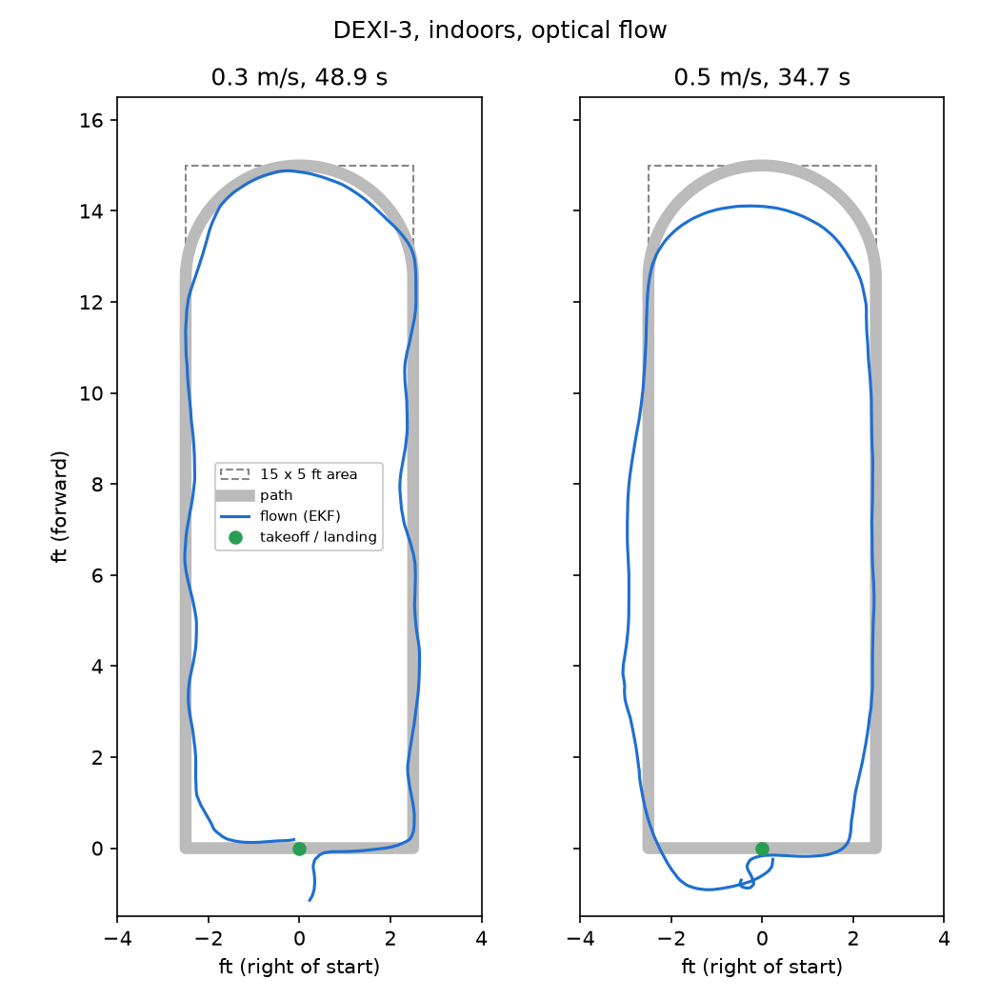

# dexi-cvx-demo

Convex optimization running onboard a DEXI drone. A CVXPY + Clarabel model predictive controller
re-plans the next 3 seconds of flight 10 times a second and streams the plan to PX4.



*Two laps on a DEXI-3 indoors, from the drone's own position estimate (`plot_lap.py`).*

<!-- Videos: [0.3 m/s lap](YOUTUBE_LINK_0.3) · [0.5 m/s lap](YOUTUBE_LINK_0.5) -->

## The racetrack

The course is laid out from the spot where the pilot arms, in the direction the drone faces. It runs 15 ft
forward along a lane 2.5 ft right of center, turns through a 2.5 ft-radius semicircle, comes back
along the left lane and lands where it took off.

Every 0.1 s the planner:
1. Finds how far along the path the drone is.
2. Takes the next 3 s of path at cruise speed as the reference.
3. Solves for the 30-step plan closest to that reference. The plan has to respect speed and
   acceleration limits and stay inside a hard 15 × 5 ft box (plus 15 cm).
4. Sends the plan to PX4 as position + velocity + acceleration setpoints (`SET_POSITION_TARGET_LOCAL_NED`, 20 Hz).

The model is a double integrator. Speed and acceleration limits are norm (second-order cone)
constraints, so each solve is a small SOCP. CVXPY compiles it once (DPP parameters) and only the
current state and reference change between solves.

## Hardware results: DEXI-3, indoors, optical flow

Companion computer: Raspberry Pi CM5, 2 GB, with DEXI-OS running.

| | 0.3 m/s | 0.5 m/s |
|---|---|---|
| Lap time | 48.9 s | 34.7 s |
| Solve time, median / max | 9.2 / 20.3 ms | 8.7 / 19.2 ms |
| Path deviation, median (EKF) | 4 cm | 9 cm |
| Landing distance from takeoff spot | 7 cm | 11 cm |
| Infeasible solves | 8 of 489 | 51 of 347 |

At 0.5 m/s the drone cuts the far turn short and swings wide on the way back.
**Known limitation:** the flight area is a hard constraint. If the drone drifts outside it (on the climb, or
swinging wide at 0.5 m/s), the problem has no solution until it is back inside, and the drone keeps flying the last good
plan. Making the area a heavily penalized soft constraint would fix this.

## SDP benchmark (`bench_sdp.py`)

Results on the same 2 GB CM5:

| Problem | Result |
|---|---|
| Lyapunov LMI, 4–12 states | 8–24 ms |
| Lyapunov LMI, 24 states | 263 ms Clarabel, 200 ms SCS |
| Parameterized 12-state LMI, re-solved in a loop | ~55 Hz |
| Max-cut relaxation, 100 × 100 (`--big`) | 36 s and 1.4 GB RAM with Clarabel, 0.37 s with SCS |

Small and medium SDPs fit comfortably within a control loop. Large SDPs with Clarabel (an interior-point
solver) are limited by memory: on a 2 GB board, stop DEXI-OS before running `--big`, or use SCS.
We recommend a 4 GB CM5 for SDP work.

## Running it

```bash
python3 -m venv .venv && .venv/bin/pip install -r requirements.txt
.venv/bin/python oval_replay.py      # no drone: simulates the lap, prints solve times
.venv/bin/python bench_sdp.py        # SDP benchmark (add --big for the 100x100 max-cut)
```

**Sim** ([dexi-sim-ftw](https://github.com/DroneBlocks/dexi-sim-ftw)): there is no pilot in the sim, so
`--sim-pilot` switches to Position mode and arms over MAVLink.

```bash
.venv/bin/python oval_fly.py --url udpout:<sim-host>:14540 --sim-pilot --speed 0.3
```

**Drone**: run on the companion computer. MAVLink comes from mavlink-router on UDP 14540.

```bash
.venv/bin/python oval_fly.py --speed 0.3 --log lap.json
```

Then:
1. Put the drone on the start spot, facing down the course, with at least 17 × 7 ft clear.
2. Arm in **Position mode**. The script never arms or disarms.
3. The script switches to OFFBOARD, climbs to 1 m (`--alt`) and checks that the heading held
   during the climb. It then flies the lap and lands.
4. To take over at any time, flip the mode switch. The script stops sending as soon as PX4 leaves OFFBOARD.

The script refuses to fly if it receives position updates slower than 8 Hz.

## Gotchas

- **Position rate.** By default the DEXI-3 sends `LOCAL_POSITION_NED` to the companion computer at
  0.5 Hz. A planner fed 2 s-old state just holds the drone in place. `px4link.py` requests 50 Hz
  with `MAV_CMD_SET_MESSAGE_INTERVAL`; about 15 Hz actually arrives, which is enough.
- **type_mask bit 9** (`0x200`) means force, not acceleration. If it is set, PX4 rejects every
  setpoint and then refuses to arm.
- **Heading on the ground.** With optical flow only, the estimate has no position fix below ~8 cm.
  The course heading is therefore taken again after the climb.

## Files

| File | |
|---|---|
| `oval_fly.py` | Racetrack: path, optimization problem, flight sequence |
| `px4link.py` | MAVLink link to PX4: 20 Hz setpoint stream, mode, arming, landing |
| `plot_lap.py` | Plot a lap from a `--log` file |
| `oval_replay.py` | The lap with no drone, to time solves on a new computer |
| `bench_sdp.py` | SDP benchmark (max-cut, Lyapunov LMIs, parameterized re-solve) |

MIT License.
